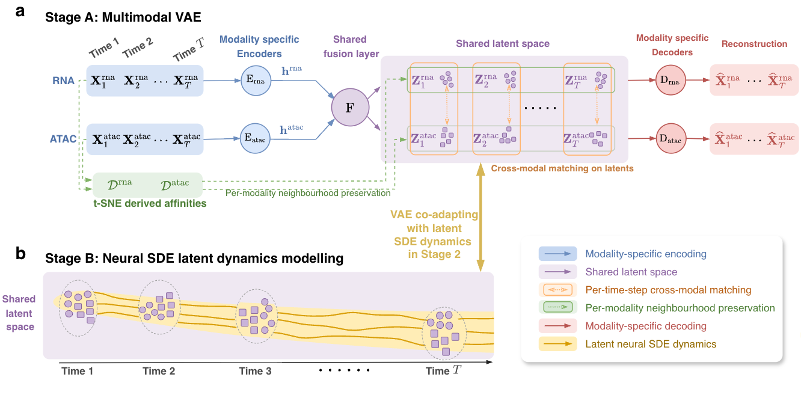

# mtvae: multimodal temporal integration with a latent SDE

`mtvae` integrates two single-cell modalities measured on *different* cells
(here snRNA-seq and snATAC-seq) across an ordered series of developmental stages,
and learns how cells move through the shared latent space over time.

* **Stage A** fits one variational autoencoder with modality-specific encoders
  and decoders and a shared stochastic fusion layer. 
* **Stage B** fits a latent neural SDE to the stage-wise cohorts and co-adapts
  the encoder and decoders with it.

Propagating cells from initial stage through the fitted SDE and decoding them gives predicted
trajectories in feature space, for example a gene's expression across
development.

Paper: *link to be added*.  Data and trained models: [figshare](https://doi.org/10.6084/m9.figshare.34971253).



## Contents

| folder | what it holds |
|---|---|
| [`mtvae/`](mtvae) | Python implementation of the method  |
| [`reproducibility/`](reproducibility) | reproduce the models fitted in the paper |
| [`tutorials/`](tutorials) | `pfc.ipynb`: using the PFC data as an example, load the PFC model, encode, latent UMAP, predicted gene trajectories |
| [`benchmark/`](benchmark) | reproducing the seven benchmark metrics and figures from pre-computed results |
| [`tests/`](tests) | CPU smoke test |

## System requirements

### Software dependency and OS
The versions used for the paper, on Linux, are pinned in `environment.yml`:

```
python = 3.12
torch = 2.8.0 (CUDA 12.8)
numpy = 2.1.2
scipy = 1.18.0
pandas = 3.0.5
scikit-learn = 1.9.0
openTSNE = 1.0.4
PyYAML = 6.0.3
scanpy = 1.12.3
anndata = 0.13.2
igraph = 1.0.0
leidenalg = 0.12.0
dcor = 0.7
umap-learn = 0.5.12
matplotlib = 3.11.1
```

### Installation guide
Run the following
```bash
pip install git+https://github.com/hwxing3259/mtscvae.git
```


## Demonstration

### Load relevant datasets

Every example reads the figshare layout (`data/`, `models/`, `benchmark/`,
`figures/`; see the figshare README).

```python
import mtvae

pfc = mtvae.load_example("pfc")                  # Herring et al. 2022 PFC, 6 stages
hc = mtvae.load_example("fourds", dataset="HC")  # one of the four benchmark datasets
print(pfc.names, [m.x.shape for m in pfc.modalities], pfc.stages)
```

### Define and train the model

One configuration covers both stages and the data handling. `for_example`
returns the recipe of the paper's fits (path-KL weight `beta_kl = 1e-4`). Any
field can be overridden, or the whole configuration read from a YAML file with
`mtvae.load_config`.

```python
cfg = mtvae.PipelineConfig.for_example("pfc", seed=44, device="cuda")
fit = mtvae.train(pfc, cfg)        # Stage A, then Stage B, in one call
z = fit.encode()                   # {"rna": (n_rna, 50), "atac": (n_atac, 50)}
```

The same from the command line. Every released fit was made by this one
command, from a config file in [`mtvae/configs/`](mtvae/configs):

```bash
python -m mtvae.fit --config mtvae/configs/pfc.yaml --seed 44 \
    --data-root $MTVAE_DATA --arm my_pfc_fit --out-root runs/
```

It writes one fit folder: `model.pt` (the final model, which loads on its
own), `latents/`, `stage_a.pt`, `stage_a_latents.npz` and `run_record.json`.

### Load a trained model, get latents and predicted trajectories

```python
from collections import OrderedDict

model = mtvae.load_model(mtvae.model_dir("pfc", seed=44))
z = model.encode(pfc)                                     # latents of every nucleus
astro = z["rna"][(pfc["rna"].stage == 0)][:300]           # some Gestation nuclei
traj = model.rollout(OrderedDict(cohort=astro), n_rollouts=5,
                     decode="rna", reduce=lambda x: x.mean(0))
expr = traj["cohort"].per_stage                           # 6 stages x 5,000 genes
```

[`tutorials/pfc.ipynb`](tutorials/pfc.ipynb) does this end to end:
the latent UMAP of both modalities and the predicted maturation of eight
astrocyte markers, checked against the paper's numbers.


## Instructions for use

**You provide** a `Dataset` of exactly two modalities (see `mtvae/data.py`):

* `Modality.x`: a cells × features float32 matrix, already normalised and
  scaled;
* `Modality.stage`: an integer stage per cell, in an ordered stage vocabulary;
* optionally:
  * `teacher`: a cells × k embedding for the neighbourhood tilt (needed when
    the tilt weight is above 0);
  * `train`: a training mask;
  * `trunk`: default is `TrunkSpec("mlp")` a dense MLP, alternatively one can set `TrunkSpec("spatial", chr_ids=...)` for a conv head;
* `Dataset.stage_times`: normalised times of the stages in [0, 1]
  (`mtvae.stage_times_from` derives them from per-cell ages).

**Teacher embeddings.** For the tilt, we recommend passing a low-dimensional embedding of each modality, such
as a PCA of the normalised RNA or an LSI of the ATAC peaks, rather than the feature
matrix itself to save compute and improve robustness; the pipeline builds the neighbour affinities from it.

**You get back:**

* a shared $d$-dimensional latent per cell;
* the fitted latent SDE;
* the two decoders.

## Reproducing the numerical examples in the paper
[`reproducibility/`](reproducibility) reproduce all fitted models reported in the paper. Figures and benchmarking results can be reproduced by scripts in [`tutorials`](tutorials) and [`benchmark/`](benchmark). 


## Pre-trained models and datasets

Data and trained models are available at [figshare](https://doi.org/10.6084/m9.figshare.34971253).

## License

MIT; see [LICENSE](LICENSE).
